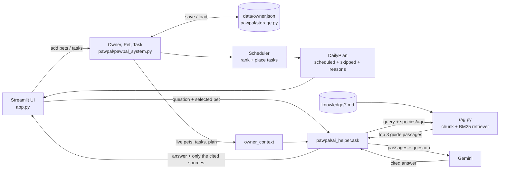

# PawPal+ with Ask PawPal

## Original project

This project extends **PawPal+**, the Streamlit pet-care planner I built in Modules 1-3. PawPal+ let an owner enter their pets and care tasks (walks, feeding, meds, grooming) with a duration, priority and category. It then generated a daily schedule and explained why each task was placed or skipped. Its goals were to turn a busy owner's task list into a realistic plan, and to keep that logic correct and testable.

## Title and summary

**PawPal+ with Ask PawPal** keeps the scheduler and adds a retrieval-augmented (RAG) care assistant, saved data and a dashboard UI.

Owners can ask questions such as "How much exercise does a senior dog need?" or "Is Mochi's walk long enough?". Answers come from a set of curated care guides in `knowledge/` and from the owner's own pets, tasks and today's plan. Every answer cites its sources. This matters because generic chatbots give inconsistent, ungrounded pet advice. Here the model may only answer from the passages it is given, and it says "I don't know" when it has nothing relevant.

## Architecture overview



- **Scheduler path:** the UI edits an `Owner` containing `Pet`s and `Task`s. `Scheduler.generate_plan()` ranks tasks (priority, then shorter duration, then name) and places them back to back from the start of the day. Tasks that don't fit go into a skipped list with a reason. `pawpal/storage.py` saves the owner to `data/owner.json`.
- **RAG path:** `pawpal/rag.py` splits each guide into one chunk per `##` section and ranks chunks with an in-memory BM25 index. `pawpal/ai_helper.py` adds the selected pet's species and age to the query, retrieves the top 5 passages, and appends a freshly built description of the owner's data. It sends all of that to Gemini with a system prompt that forces grounded, cited answers. The UI then shows only the sources the answer actually cites.
- **Guardrails:** a minimum retrieval score, a "don't know" instruction, no-key and API-error fallbacks that never crash the app, and a vet referral for medical questions.

## Project structure

```
app.py                 Streamlit UI (entry point)
main.py                CLI demo of the scheduler
pawpal/                Application code
  pawpal_system.py       Owner, Pet, Task, Scheduler, DailyPlan
  rag.py                 Guide chunking + BM25 retriever
  ai_helper.py           Gemini prompt, owner context, cited answers
  storage.py             JSON save/load of the owner
knowledge/             Care guides the RAG feature searches (*.md)
data/                  Saved owner data (owner.json, git-ignored)
tests/                 pytest suite
docs/                  Feature spec, RAG diagram, UML (diagrams/), context
README.md, reflection.md, requirements.txt, .env.example
```

## Setup instructions

1. Clone the repo and open a terminal in it.
2. Create and activate a virtual environment:
   ```bash
   python -m venv .venv
   source .venv/bin/activate      # Windows: .venv\Scripts\activate
   ```
3. Install dependencies:
   ```bash
   pip install -r requirements.txt
   ```
4. Add your Gemini API key (optional, only needed for Ask PawPal answers):
   ```bash
   cp .env.example .env           # then edit .env: GEMINI_API_KEY=your-key
   ```
5. Run the app:
   ```bash
   streamlit run app.py
   ```
6. Run the tests (no key or network needed):
   ```bash
   pytest
   ```

Without a key, the scheduler works normally and Ask PawPal shows "AI is not configured".

## Using the app

| Section | What you can do |
|---------|-----------------|
| **Owner** | Edit the owner name (the day runs 08:00-18:00 by default). |
| **Pets** | Add a pet with name, species and age. |
| **Tasks** | Pick a pet, then add a task with a title, duration (1-240 min), priority and category. |
| **Build Schedule** | Generate today's plan, with a reason for each task and a list of skipped tasks. |
| **Ask PawPal** | Ask a care question, optionally for one of your pets, and get a cited answer. |

Example plan output:

```
Plan for 2026-10-20 (45 min scheduled)
  08:00-08:15  Whiskers: Feed Whiskers [medium] - medium priority, 15 min
  08:15-08:45  Buddy: Walk Buddy [low] - low priority, 30 min
```

Scheduler behaviors: tasks from all pets are merged and ranked by priority, then shorter duration, then name. Tasks are placed back to back so they never overlap. A task that doesn't fit, or exceeds the max task length, is skipped with a reason, and later shorter tasks can still be scheduled. Completed tasks are left out. Conflict warnings and recurring tasks are not implemented.

## Sample interactions

These are real outputs from the app (model `gemini-3.5-flash-lite`). The saved owner is Jordan, who has one dog, Mochi (1 year old), with a single 20-minute "Morning walk".

**1. General care question**

> **Q:** How much exercise does a senior dog need?
>
> **A:** Hi there! Senior dogs still need daily walks, but they should be shorter and gentler [senior-pets.md]. You can try two or three 15 to 20 minute walks a day instead of one long one, while avoiding hard running or jumping [senior-pets.md]. For anything medical or urgent, please contact a vet!
>
> *Top retrieved passage:* `senior-pets.md` / "Exercise for senior dogs" (BM25 score 7.1)

**2. Another guide, different species**

> **Q:** How often should I groom a cat?
>
> **A:** How often you should groom a cat depends on their coat:
> - Short-haired cats need brushing about once a week [cat-care.md].
> - Long-haired cats need brushing every day or two to prevent mats [cat-care.md].

**3. Question that combines the owner's data with the guides**

> **Q:** Is Mochi's walk long enough? *(Mochi selected)*
>
> **A:** Mochi is a 1-year-old dog [Your PawPal data]. According to the care guides, most adult dogs need 30 to 60 minutes of exercise per day, usually split into two or more walks [dog-exercise.md]. Mochi currently has 1 task, 20 minutes in total scheduled (Morning walk: 20 min) [Your PawPal data]. Since this is less than the general recommendation of 30 to 60 minutes, you may want to adjust.

**4. Out-of-scope question (guardrail)**

> **Q:** What is the capital of France?
>
> **A:** I don't know.
>
> Retrieval returns no passages for this question. With no pets saved the app short-circuits to "I don't have guidance on that yet" without calling the model. Here the owner's data was still sent, so the model was called and declined to answer.

## Design decisions and trade-offs

- **Retrieval over fine-tuning or a bare LLM.** Grounding answers in `knowledge/` makes them traceable and easy to correct (edit a markdown file). The cost is that the assistant only knows what the guides contain.
- **BM25 instead of embeddings or a vector database.** The guides are small, so keyword search is fast, runs offline and is easy to test. The trade-off is that it misses synonyms. For "How often should I groom a cat?" the best-ranked chunk is `senior-pets.md` (score 2.4), ahead of the cat grooming section (1.9).
- **Owner data is injected, not retrieved.** It is small, and building it fresh from the live `Owner` on every question means it can't go stale. Totals are precomputed so the model quotes them instead of doing arithmetic. The system prompt still requires care advice to come from the guides, never from the owner's data alone.
- **Show only cited sources.** Keyword retrieval can surface loosely related chunks, so the UI lists only the sources the answer cites. This is more honest than displaying every hit.
- **Never crash.** A missing key or API error returns a friendly message, so the scheduler keeps working. This costs some visibility into failures.
- **Scheduler stays simple and deterministic.** Priority first, then time. It ignores owner preferences when ranking, because a predictable plan is easier to explain and test. The trade-off is that preferences don't influence the order.
- **JSON persistence.** One file, no database. This is fine for a single-user app.

## Testing summary

- **25 automated tests pass** (`pytest`, about 0.3 s, fully offline).
  - `test_pawpal.py`: sort order (priority, then duration), back-to-back placement, empty plans, duplicates, skipped tasks.
  - `test_rag.py`: chunking, BM25 ranking, out-of-scope queries returning nothing, the cited-sources filter, and answer generation with the Gemini client mocked.
  - `test_storage.py`: save/load round trip, and a missing or corrupt file returning `None`.
- **What worked:** mocking the Gemini client let the whole RAG pipeline be tested without a key. The minimum-score cutoff reliably rejects off-topic questions at the retrieval stage.
- **What didn't:** keyword retrieval can rank the wrong chunk first (the cat-grooming query above). Duplicate tasks are scheduled without a warning, and conflict detection and recurring tasks are not implemented. Live model replies can't be unit tested, so I checked them by hand. I also saw the model open answers with filler greetings and repeat the vet disclaimer, which the prompt doesn't fully prevent.
- **Learned:** retrieval quality limits answer quality more than the model does, so the tests that matter most are the ones on retrieval and on the "I don't know" path. My confidence in the scheduler is 4/5.

## Reflection

Building this showed me that adding AI to an app is mostly an engineering problem around the model, not the model itself. Chunking, ranking, thresholds, prompts and fallbacks decide whether the answers are trustworthy. Constraining the model to cited passages mattered more than choosing a clever prompt. Starting from a small, tested scheduler also gave me a stable base to attach the AI feature to without breaking it.

The graded responsible-AI reflection is in `model_card.md`. See also `reflection.md` (design and AI-collaboration notes) and `docs/RAG_FEATURE.md` (feature spec).
